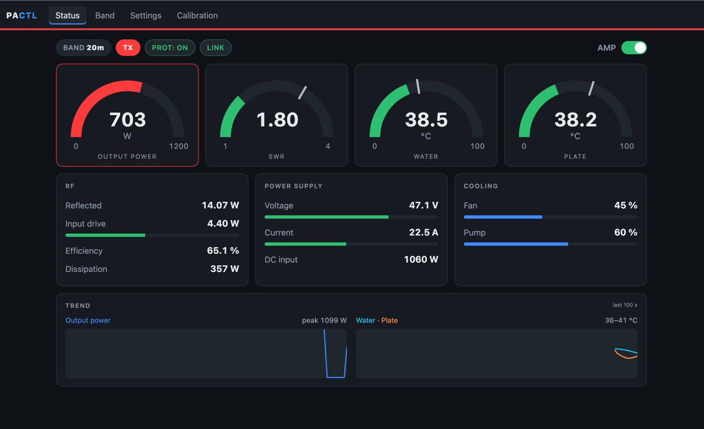
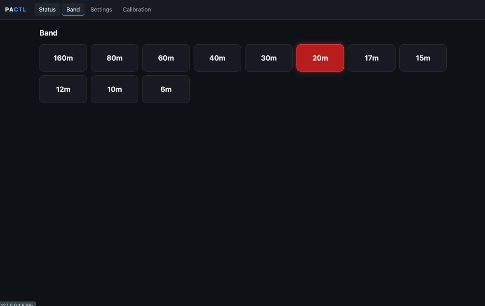
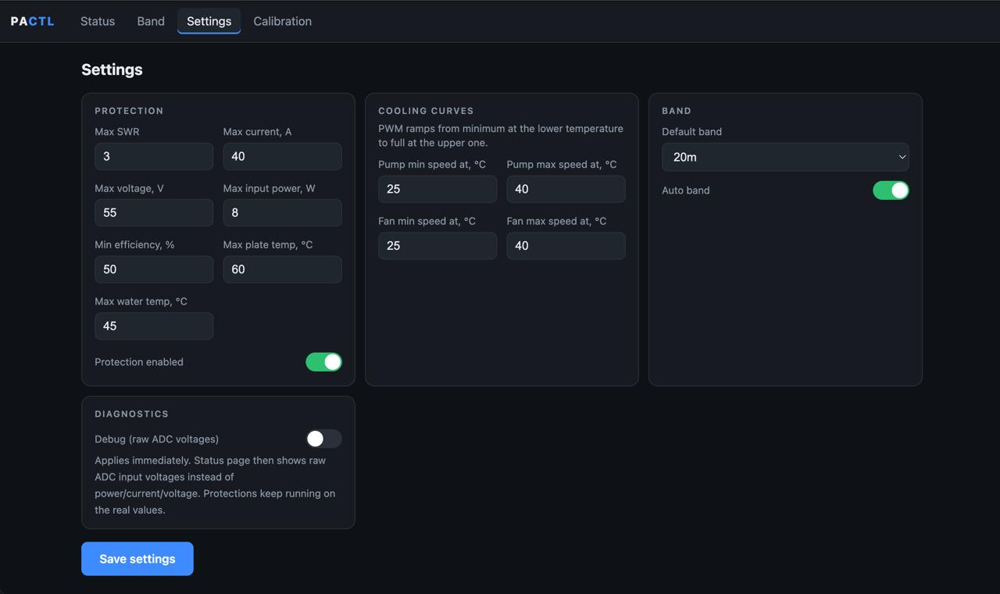
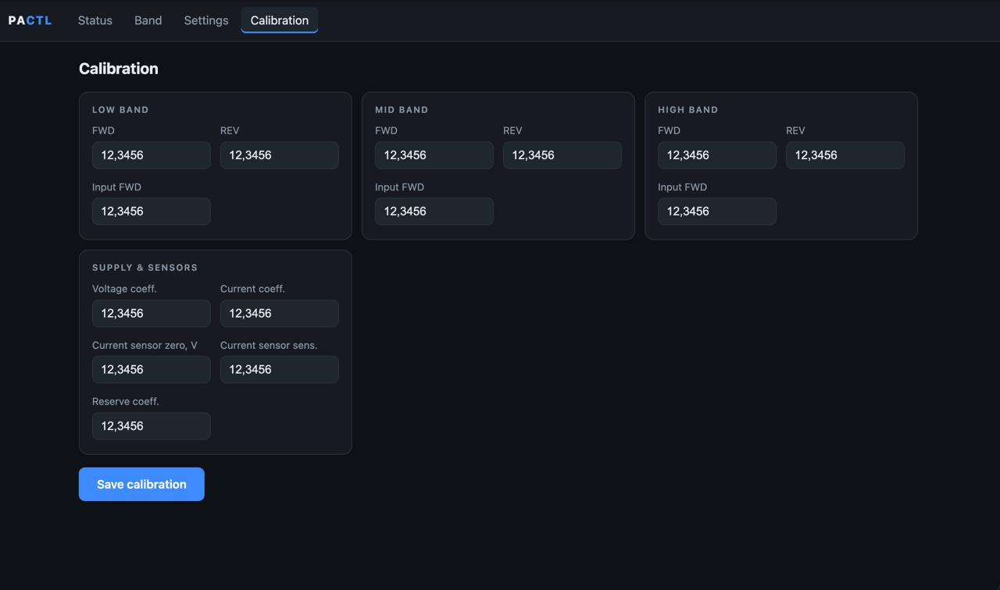
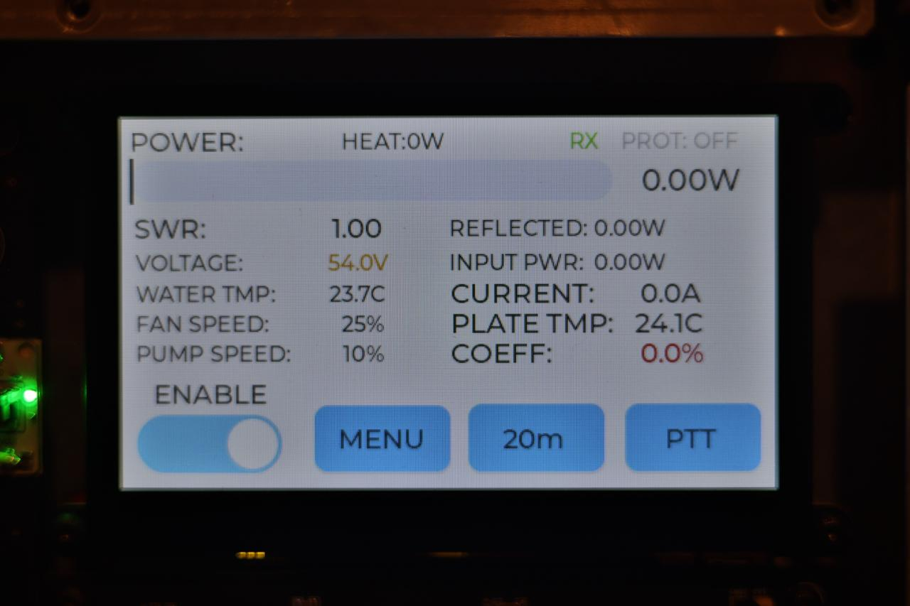
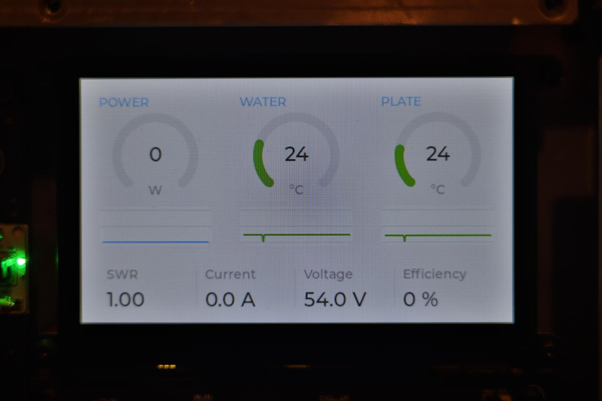
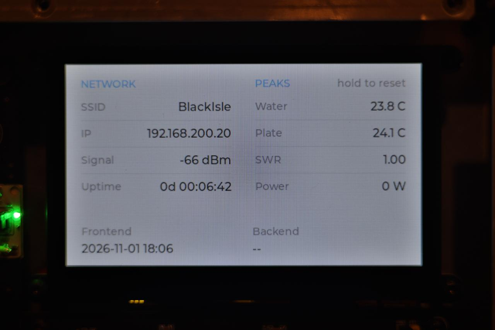
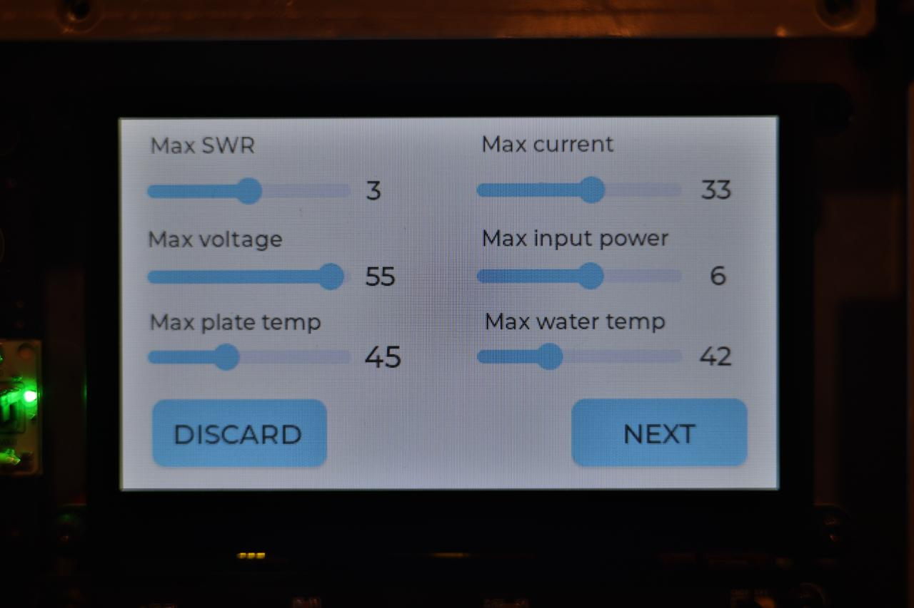
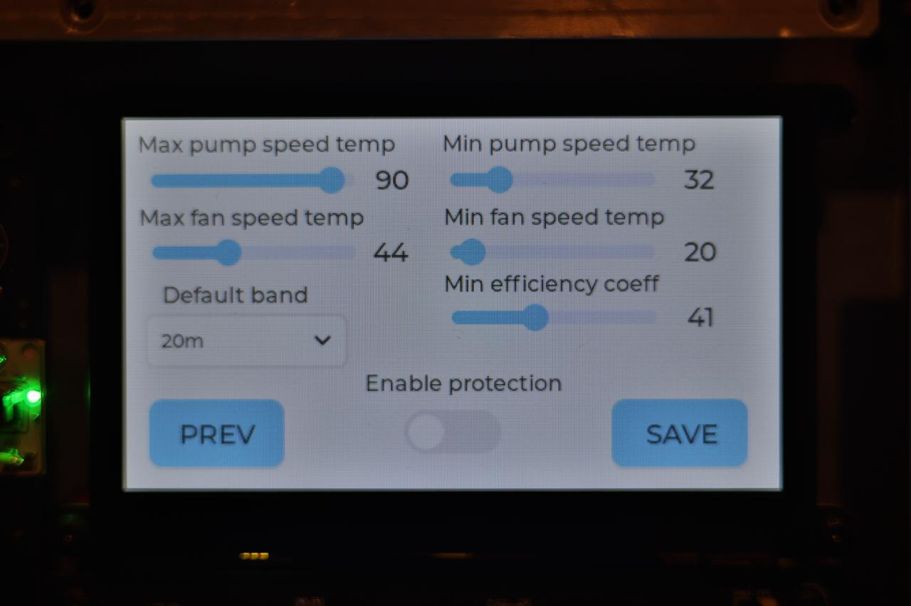
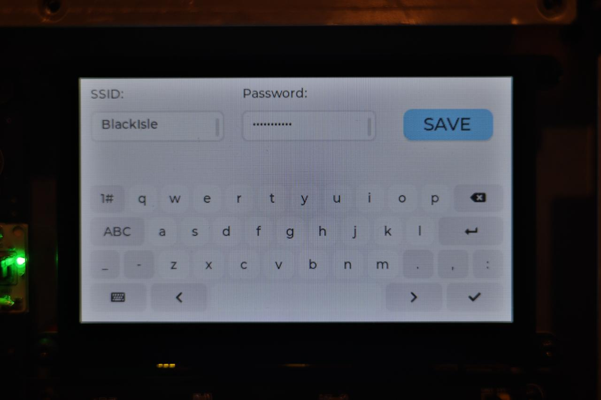

Frontend for pa_ctl_backend HF power amplifier controller.  
It's for Guition JC4827W543 esp32s3 module. 
The project in alfa state and still under development.  
Looks like it requires some refactoring :) 
 
Few web screenshots: 

Few interface photos: 

Backend code - https://github.com/enthru/pa_ctl_backend  
Backend hardware - https://oshwlab.com/enthru/pa_ctl
